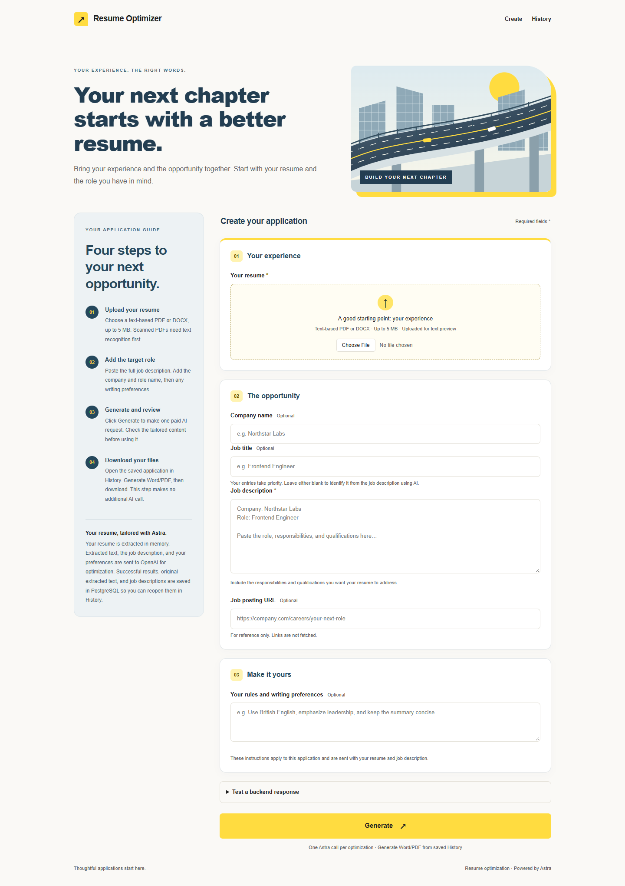

# AI Resume Optimizer



A Next.js + TypeScript frontend with a NestJS API and a PostgreSQL history
database. The application provides a request/response and persistence
flow with PDF/DOCX extraction and GPT-6 Astra resume optimization. Generate makes one paid AI call, displays a structured tailored draft, and saves it with the job description in PostgreSQL. Mock history remains available for development. Word/PDF generation and Garage storage are available from saved History records. Authentication and OCR are not implemented.

## Run locally

Use Node.js 24 LTS and PostgreSQL 17. For the supplied local database setup,
install and start Docker Desktop. Install LibreOffice Writer for Word-to-PDF conversion. From the repository root in PowerShell:

```powershell
npm ci
Copy-Item backend/.env.example backend/.env
npm run db:up
npm run db:setup
npm run dev
```

Copy the environment example only on first setup; do not overwrite your existing
backend/.env. If you already have a PostgreSQL server, skip Docker and set
DATABASE_URL in backend/.env to your existing database connection string.
Create the database first, then run `npm run db:setup` to apply migrations.
The API inserts demo rows on startup but no longer creates tables itself.

Open http://localhost:3000. One command starts both services:

- Next.js frontend: port 3000.
- NestJS backend: port 3001, bound to localhost.
- History: http://localhost:3000/history.

If an old frontend is running, stop it with Ctrl+C first. Both ports should be free.
Prisma migrations create the generations table; the backend inserts three fictional demo
records. Records survive restarts; demo rows are not duplicated. Docker stores
database files in a named volume. `npm run db:down` stops the database without
deleting that volume. Compose binds PostgreSQL to localhost port 5432.
The supplied password is for local development only; use separate credentials
and your provider's TLS requirements for a hosted server.

Optional configuration:

- Copy .env.example to .env.local for Next.js configuration.
- DATABASE_URL in backend/.env configures the API's PostgreSQL connection.
- Preview and mock tests need no API key. Astra requires OPENAI_API_KEY in the ignored backend/.env. Restart the API after changing it.
- Owner prompt rules live in ignored backend/prompts/resume.local.txt, with a generic public fallback. See [private prompt setup](backend/prompts/README.md). Users can provide their own rules in the form’s optional writing-preferences field.
- Change API_PORT and API_BASE_URL together if changing the backend port.
- SEED_DEMO=false stops inserting demo rows; existing rows are preserved.
- MOCK_SCENARIOS=false disables error simulations. NODE_ENV=production always
  disables simulations and demo seeding, but existing demo records remain.

## Local S3-compatible storage

Garage is an optional Compose service with persistent data and metadata volumes.
Start Docker Desktop, then run from the repository root:

```powershell
npm run storage:up
npm run storage:test
```

Local credentials are generated into the ignored .env.storage file. The private
resume-documents bucket is created at startup. Development storage uses port 3900;
image Compose uses 3904. The backend SDK is installed; AI history is saved in PostgreSQL; Word/PDF files are generated on request from
History and stored in Garage.
See [Garage setup and reading guide](infra/garage/README.md) for signed-link tests,
container-recreation persistence checks, and storage configuration files.

## How to use

1. Choose a PDF or DOCX (nonempty, up to 5 MB).
2. Optionally enter Company name and Job title. Each manual entry takes priority; blank fields are extracted by AI from the job description in the same request. Unknown values display as not specified. Existing history is unchanged. Paste a job description, for example:

```text
Company: Example Company
Role: Frontend Engineer

Build accessible React applications with TypeScript.
```

3. Click Generate. The resume is uploaded once; Astra tailors it to the job, then original and optimized text appear together. Open the saved result in History later without another model request.
4. History lists saved AI resumes; open one to see its original text, JD and optimized content. Development mock records remain in a separate expandable section.
5. Expand Test a backend response to select a failure, then click Generate.
   Inputs remain available to retry. Failed simulations do not save records.

The frontend prevents duplicate in-flight submissions and uses an 8-second
timeout for mock requests, 30 seconds for preview uploads, and 120 seconds for AI optimization. Each successful mock submission creates a history record; successful AI submissions save a complete snapshot. Check History before retrying after a timeout; retrying AI makes a new paid request.

### Development mock scenarios (no AI calls)

- Success: HTTP 201 with a saved mock record.
- Resume rejected: HTTP 422.
- Rate limit: HTTP 429.
- Service unavailable: HTTP 503.
- Server error: HTTP 500.
- Backend timeout: HTTP 504.
- Slow connection: the server waits 12 seconds, then fails without writing;
  the browser times out after 8 seconds.

These scenario controls are simulations. The upload endpoint also returns real validation and extraction errors.
To test a real unavailable backend, run only npm run dev:web while the API is
stopped. Generate and History show connection errors. Start npm run dev:api and
retry; reload Create to discover the available simulation controls.

## API

All endpoints are prefixed with /api:

- GET /health: service status.
- GET /capabilities: mock mode and whether error simulations are enabled.
- GET /generations: latest 50 records, newest first.
- POST /generations: validate JSON, simulate an outcome, and save a mock record on success.
- POST /optimizations: validate a multipart resume and job description, extract text, call Astra once, save the result, and return the draft plus saved ID and token usage.
- GET /optimizations: latest 50 saved AI application summaries.
- GET /optimizations/:id: saved structured resume, plain text, source text, JD and usage; no AI request.
- POST /optimizations/:id/documents: generate/store a Word/PDF pair from the saved content.
- GET /optimizations/:id/documents/:format: get a temporary docx/pdf download link.
- DELETE /optimizations/:id: delete tracked files, then the saved application.
- POST /documents/preview: validate one multipart resume upload and return extracted text without saving the file or text.

Example JSON:

```json
{
  "resumeFilename": "example.pdf",
  "resumeSize": 1024,
  "jobDescription": "Company: Example Company\nRole: Engineer",
  "scenario": "success"
}
```

Optional jobUrl must be HTTP(S); optional customPrompt is limited to 5,000
characters. Job descriptions are limited to 30,000 characters. Unknown fields,
unknown scenarios, missing required data, and invalid types return HTTP 400.
Errors use { "statusCode": 400, "error": { "code": "...", "message": "..." } }.

The browser uploads the actual resume and job fields once to POST /api/optimizations
as multipart FormData. The response includes original extracted text and the
optimized resume, displayed together after success. Explicit development mock
scenarios call /documents/preview first, then /generations; their original text
preview remains visible if mock saving fails.
Legacy mock records store only company, role, filename, ID, timestamp, source and status.
AI applications additionally persist extracted source text, JD and optional URL,
validated structured resume, derived plain text, changes, model and token usage.
Neither private server rules nor candidate customPrompt text is persisted.
History is shared by anyone who can access this personal installation; there is
no per-user authentication yet.
Manual company/title fields override AI-extracted values independently. Explicit Company: and Role: / Job title: lines are a fallback; otherwise labels
say "not specified". No additional AI call is made for these labels.

## Structure and request flow

```text
src/
  app/                   Next.js pages, styling, /history
  components/            Form, shared navigation, history list
  lib/api.ts             Fetch, timeout, and error handling
  lib/documents/         Browser file metadata checks
  lib/ai/                AI boundary documentation
  types/                 Frontend data contracts
backend/
  src/main.ts            API startup and environment loading
  src/app.ts             Nest module, request validation, error filter
  src/generations/       Controller, DTO, mock orchestration
  prisma/schema.prisma  Legacy Generation and real Application models
  prisma/migrations/    Versioned SQL migrations, committed to Git
  prisma.config.ts      Prisma CLI configuration and connection settings
  scripts/db-setup.cjs   Safe first-time migration / legacy adoption
  src/database/          Prisma queries, demo seeding, connection settings
  src/generated/prisma/ Generated Prisma Client, ignored by Git
  src/common/            Consistent JSON errors
  test/                  HTTP integration and persistence tests
compose.yaml             Local PostgreSQL service and persistent volume
.github/workflows/        Frontend/backend CI
```

Browser form → /api/optimizations → Next.js proxy → NestJS validation/extraction
→ Astra structured output → PostgreSQL Application snapshot → preview/History.
Mock scenarios retain the separate /api/generations flow.

History uses the same proxy and database. NestJS owns the backend logic.
The backend uses Prisma ORM 7 with its PostgreSQL adapter (pg remains the driver).
DatabaseService calls `prisma.generation.findMany`, `create`, and `createMany`.
Database operations are asynchronous. Timestamps use PostgreSQL TIMESTAMPTZ and
are returned to the frontend as ISO strings. Prisma maps camelCase fields to the
existing snake_case database columns. The initial migration retains the existing
CHECK constraints; Prisma's schema language does not describe these constraints.

### Prisma workflow

- `npm run db:setup`: apply committed migrations to a new database. For an existing
  table from the previous milestone, first verify its shape with Prisma Migrate
  Diff, check for the legacy restrictions, then baseline the initial migration.
  Existing records are retained. A mismatched schema stops setup; it never resets
  the database. Run setup once at a time while the API is stopped.
- After editing schema.prisma: `npm run db:migrate -- --name describe_change`
  creates and applies a development migration. Review and commit the SQL.
- `npm run prisma:generate`: refresh the TypeScript client after schema edits.
  Backend dev, typecheck, and build already run this automatically.
- `npm run db:deploy`: apply committed migrations in deployment, before starting
  the API. It does not create new migrations or seed demo records.
- `npm run db:studio`: open Prisma's database viewer locally.

Migration creation may need permission to create a shadow database; the local
Compose user has it. Keep generated client files out of Git, but commit the
schema and migrations. Generation and builds do not require a running database.

The previous ignored SQLite file, if present, is left untouched and no longer
used. Its records are not automatically imported; PostgreSQL starts with the
three fictional demo records.

## Commands and CI

- npm run dev: start both services and watch for changes.
- npm run db:up: start PostgreSQL with Docker Compose and wait until healthy.
- npm run db:down: stop PostgreSQL while preserving its volume.
- npm run dev:web / npm run dev:api: run services separately.
- npm run lint: lint frontend and backend source.
- npm run typecheck: check frontend and backend types.
- npm test: real HTTP tests against isolated temporary PostgreSQL schemas.
- npm run build: compile NestJS and create the Next.js production build.
- npm start: serve the built frontend.
- npm run start:api: serve the built backend in a separate terminal.

GitHub Actions installs the workspace from the root lockfile, then runs lint,
type checking, API tests, and both builds. CI starts a PostgreSQL service container;
no hosted database account or API key is required.
Locally, set TEST_DATABASE_URL in backend/.env and start PostgreSQL before testing.
Tests require permission to create schemas. They create randomly named schemas
and drop only those schemas afterward; they never truncate application tables.
Tests cover seeded history, server validation, error responses, successful writes,
SQL parameterization, production simulation restrictions, delayed failure, restart persistence, and
empty history. Tests also apply migrations on fresh schemas and verify existing
history survives baselining and repeated setup. Browser checks cover interaction
and display separately.

The root npm overrides select patched deepmerge-ts and mysql2 versions for
Prisma's tooling dependencies; the application itself uses PostgreSQL only.

## Privacy and next milestones

This is a local, single-user development app. There is no authentication and all
history is shared. Do not expose it publicly with real personal data. Public
deployment needs access controls and actual request/usage limits.

Next: real uploads with server-side signature and content checks; DOCX/PDF parsing;
a server-only AI provider; structured output validation; deterministic export
templates. Keep API keys out of browser code.

Commit source, package-lock.json, and empty environment examples. .gitignore
excludes databases, secrets, private documents, generated output, and dependencies.

References: [NestJS validation](https://docs.nestjs.com/techniques/validation),
[exception filters](https://docs.nestjs.com/exception-filters),
[Prisma with NestJS](https://docs.nestjs.com/recipes/prisma).

See src/lib/documents/README.md for upload limits, extraction behavior, and tests.

For the current AI workflow, prompt policy, runtime secrets and limits, see [Astra integration](backend/src/ai/README.md).

## Structured resumes and saved AI history

See [implementation and reading guide](backend/src/ai/HISTORY.md) for the agreed
sections, database migration, error behavior, new pages, and all files changed.

## Word and PDF files

Open a saved application in History and choose Generate Word and PDF. Downloads
become available after both files are stored. Regenerate changes formatting without
an AI call. Delete application removes its tracked files and database snapshot.
Host development needs LibreOffice Writer; the API image and CI install it.
Run `npm run exports:test` for a synthetic end-to-end check with local PostgreSQL
and Garage. See [export setup and reading guide](backend/src/exports/README.md).

## Customize the AI integration

The default implementation uses the OpenAI Responses API in
[astra.client.ts](backend/src/ai/astra.client.ts). Bring your own API key and
provider account; API usage is billed separately. No key is included in this
repository.

1. Copy backend/.env.example to backend/.env only on first setup.
2. Set OPENAI_API_KEY in that backend file and leave RESUME_AI_ENABLED=true.
3. Restart the backend. Never put the key in frontend code or a NEXT_PUBLIC_ variable.
4. Submit a small example and review its output before using real applications.

### Customize instructions

- For one application, enter instructions in the form's optional writing-preferences field.
- For installation-wide rules, create backend/prompts/resume.local.txt containing
  plain UTF-8 text. This file is ignored by Git and excluded from Docker builds.
- Alternatively set RESUME_PROMPT_FILE in backend/.env; relative paths resolve
  from backend/. An explicitly configured missing or empty file causes an error.
- Without a private file, the public default in
  [resume.prompt.ts](backend/src/ai/resume.prompt.ts) is used.
- The public output contract is appended to your rules so the returned sections
  still work with validation, history and exports. Keep personal facts accurate
  and avoid asking the model to invent employment, credentials or achievements.
- Docker deployment mounts the private prompt folder at runtime. Provide your own
  file on the deployment host; GitHub does not contain the owner's private rules.

### Change models or providers

The model is currently the ASTRA_MODEL constant in
[astra.client.ts](backend/src/ai/astra.client.ts), not an environment setting.
To switch models, edit that constant and check the target model's support for
strict JSON-schema output, reasoning settings and output token limits. Update
model-specific UI labels and tests as well.

To use a different provider, adapt the request URL, authentication, request body
and response parsing inside the server-side client. Return the same
resume/resumeText/changes/skillsAdded/model/usage contract. Keep
[resume.schema.ts](backend/src/ai/resume.schema.ts) validation before saving.
Provider APIs are not interchangeable just because they accept an API key.

The current client has a 90-second deadline, no automatic billable retries, and
sanitized errors. Preserve these protections and update mocked provider tests in
backend/test/ai.test.cjs when changing the integration. Do not commit real keys,
private prompts, resumes, or provider response dumps.

### Customize the generated documents

Edit [resume-renderer.ts](backend/src/exports/resume-renderer.ts) for typography,
spacing and section layout, then regenerate files from History. This uses saved
content without another AI charge. Install LibreOffice Writer locally for PDF
conversion; the backend Docker image includes it.

## Development and contributions

Use npm ci from the repository root; the root lockfile manages both workspaces.
Before proposing changes run npm run lint, npm run typecheck and npm test.
Database tests require PostgreSQL and TEST_DATABASE_URL; rendering tests require
LibreOffice. npm run exports:test additionally requires Garage. These tests use
synthetic fixtures and do not require a paid AI call.

Keep changes focused, describe how they were checked, and commit schema migrations
with database changes. Do not add local environment files or generated resumes.
This project currently has no user authentication: use it locally with personal
data until access controls are implemented.

## Track submitted applications

History has Generated and Applied sections. Click Applied on a generated resume
after submitting your application to the employer. It moves to Applied and stays
there across refreshes and server restarts. Move back to Generated undoes the change.
This tracks your progress only; it does not submit anything to a job website or call AI.
Each section shows its latest 50 records by creation date.

Apply the new additive migration with npm run db:deploy before starting the updated
backend. Existing applications start in Generated; saved content and files are retained.
PATCH /api/optimizations/:id/status accepts { "applied": true } or false.
GET /api/optimizations?status=generated (or applied) filters before the 50-record limit.
